# Суфлёр × Chatbase: как сейчас → оригинал → предлагаемый вариант

**25 ноября 2026. Статус: предложения для решения владельца, в приложение не внедрены.**

[PDF-альбом](comparison.pdf) · [HTML-альбом](index.html) · [Интерактивные концепты](prototype.html) · [Измерения](measurements.json) · [Практики UX](research.md)

GitHub показывает изображения в этом документе. HTML-файлы можно скачать вместе с папкой и открыть локально; исходники на GitHub не запускаются как веб-приложение. В HTML есть переключение ширины, увеличение изображений и локальный список решений с экспортом JSON.

Проверялся только «Суфлёр» на https://sufler.site/; Chatbase — сравнительный ориентир. Proofwall исключён.

**Объём доказательств:** живые публичные экраны и пустой тестовый кабинет Суфлёра; 70 публичных сочетаний экрана/темы/ширины, 8 сочетаний кабинета. Ошибки, прогресс и ответы воспроизведены на настоящем frontend с подменой данных только в браузере. Вызовов моделей Суфлёра и создания ботов — 0. Публичные страницы Chatbase сняты живыми; закрытые экраны показаны иллюстрациями его официальной документации. Доступ к кабинету Chatbase не предоставлен.

**Уже хорошо:** в проверенных состояниях нет горизонтального переполнения, обе темы работают, автоматические проверки доступности не нашли нарушений выбранных правил. Это не полный аудит WCAG. На 375×667 основной CTA уже виден; отдельное предложение U08 относится к 320×568. Источники ответа и отказ при нехватке данных сохраняются в концептах.

## Очерёдность для обсуждения

| Приоритет | Предложение | Тип работ |
|---|---|---|
| P2 | [U01 — Показать продукт уже в первом экране](#u01) | UI и тексты |
| P1 | [U02 — Сразу объяснить выбор «сайт или PDF»](#u02) | UI + навигация и сохранение выбора |
| P1 | [U03 — Превратить пустой кабинет в короткий первый запуск](#u03) | UI + навигация |
| P1 | [U04 — Помочь вернуться в аккаунт](#u04) | Переключатель — UI; восстановление — API + письмо |
| P2 | [U05 — Объяснить тариф через задачу бизнеса](#u05) | UI и тексты; продуктовая сверка условий |
| P1 | [U06 — Из ошибки вести к выполнимому действию](#u06) | UI + маршрутизация; проверить условия сохранения |
| P1 | [U07 — Отделить проверку ответа от призыва к сохранению](#u07) | UI; сохранение списка проверок потребует отдельного решения |
| P2 | [U08 — Уместить главное действие на коротком экране](#u08) | UI и тексты |
| P2 | [U09 — Установка: скопировать → разместить → проверить](#u09) | Сначала дополнительный аудит; затем оценка |

P1 — основной путь пользователя; P2 — дополнительное улучшение. Оценка приоритета принадлежит команде. Измеренного прироста конверсии нет. U09 требует дополнительной проверки текущего экрана установки.

## U01 · Показать продукт уже в первом экране

**P2 · Дизайнерская гипотеза.**

<table><tr><th>Как сейчас</th><th>Как в Chatbase</th><th>Предлагаемый вариант</th></tr><tr><td><a href="assets/sufler-home-dark-1440.png">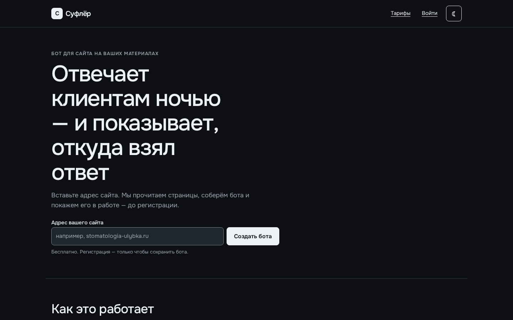</a></td><td><a href="assets/chatbase-home-1440.png">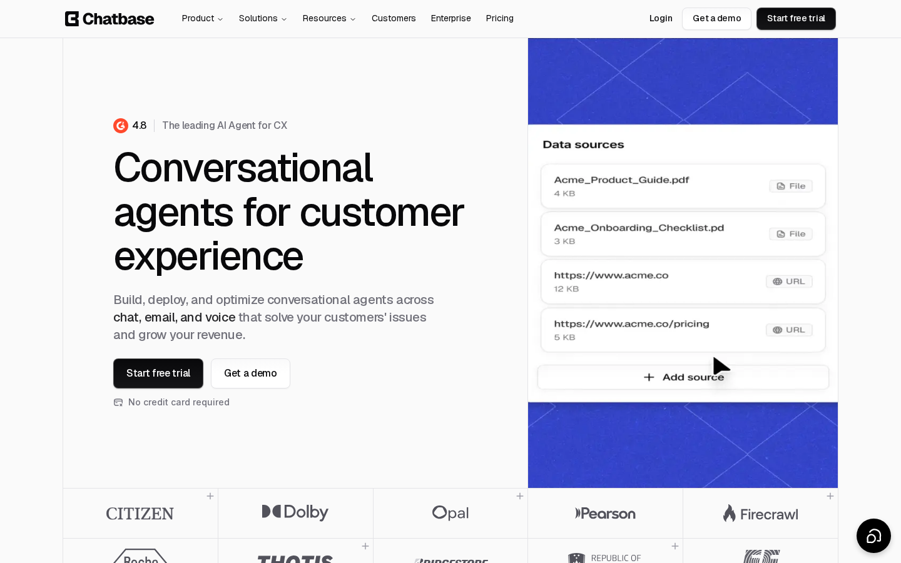</a></td><td><a href="assets/proposed-landing-dark-1440.png">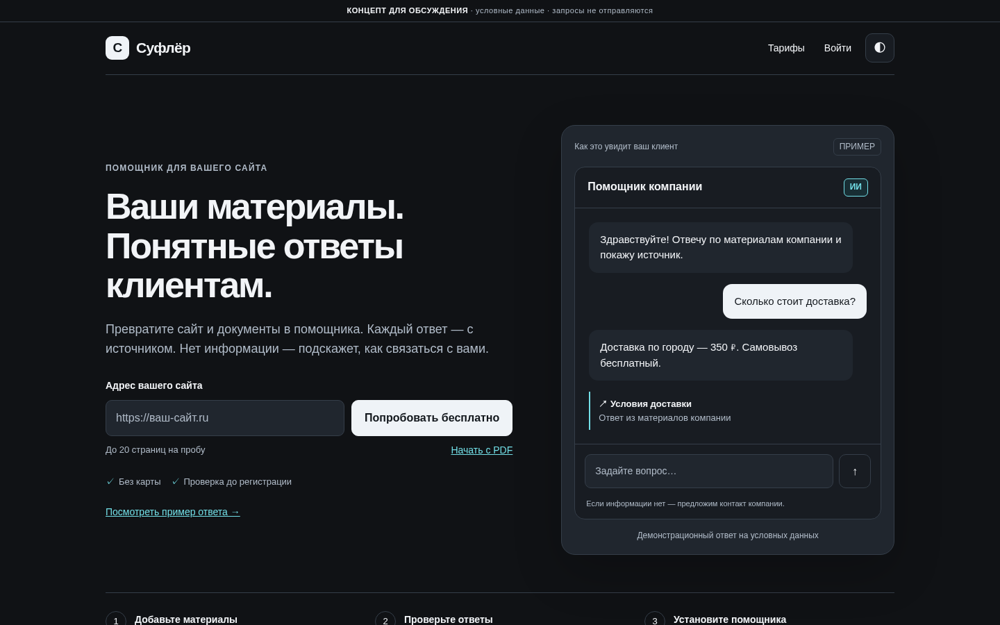</a></td></tr></table>

**Доказательства:** Живой публичный экран Суфлёра. Оригинал: Живой публичный экран Chatbase.

**Сейчас:** На десктопе первый экран занят текстом и формой слева; пример ответа находится ниже. Справа нет изображения самого продукта.

**Предлагаем:** Сократить заголовок и рядом показать условный диалог с источником. Сохранить возможность попробовать до регистрации.

**Критерий:** На 1440×900 видны обещание, поле, основное действие и пример ответа. Пример явно помечен как демонстрационный.

**Объём:** UI и тексты. [Открыть HTML-концепт](prototype.html?screen=landing).

Источники: [Chatbase — главная](https://www.chatbase.co/), [Microsoft HAX — границы возможностей](https://www.microsoft.com/en-us/haxtoolkit/guideline/make-clear-what-the-system-can-do/), [Google PAIR — Explainability + Trust](https://pair.withgoogle.com/guidebook-v2/chapter/explainability-trust/).

## U02 · Сразу объяснить выбор «сайт или PDF»

**P1 · Наблюдение + предложение.**

<table><tr><th>Как сейчас</th><th>Как в Chatbase</th><th>Предлагаемый вариант</th></tr><tr><td><a href="assets/sufler-preview-dark-1440.png">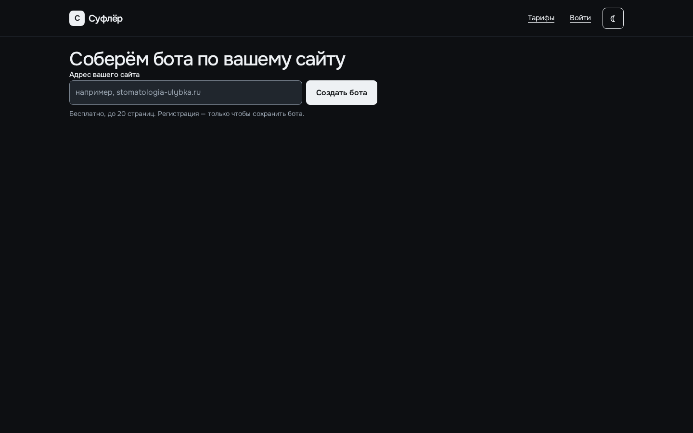</a></td><td><a href="assets/chatbase-doc-onboarding.png">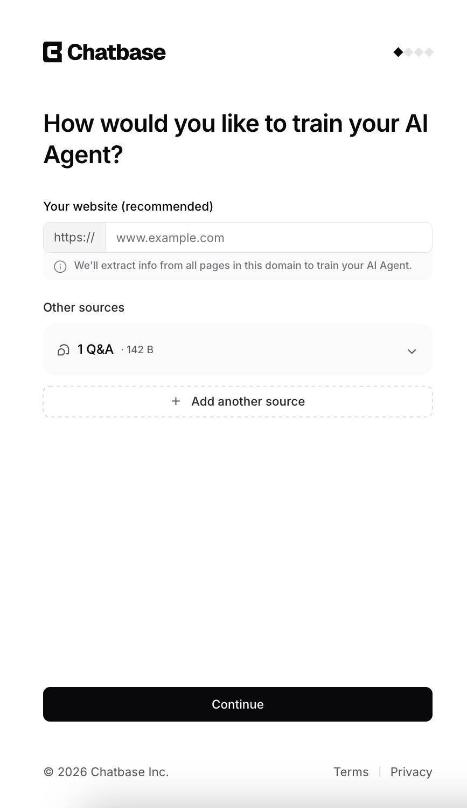</a></td><td><a href="assets/proposed-sources-dark-1440.png">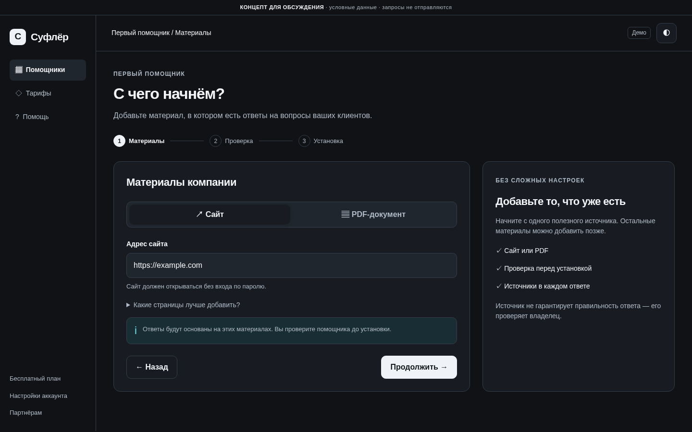</a></td></tr></table>

**Доказательства:** Живой публичный экран /preview. Оригинал: Иллюстрация официальной документации Chatbase.

**Сейчас:** Первый шаг предлагает только адрес сайта. Возможность PDF упоминается на лендинге, но отдельного входа в этот сценарий на форме нет.

**Предлагаем:** Единый выбор «Сайт / PDF» с понятными ограничениями. Загрузка PDF остаётся в авторизованном кабинете; публичный переход должен явно вести к входу.

**Критерий:** Путь к сайту и путь к PDF видны до ввода. Ограничения указаны рядом; выбранный способ не теряется после входа.

**Объём:** UI + навигация и сохранение выбора. [Открыть HTML-концепт](prototype.html?screen=sources).

Источники: [Chatbase — первый помощник](https://www.chatbase.co/docs/user-guides/quick-start/your-first-agent), [Chatbase — источники](https://www.chatbase.co/docs/user-guides/chatbot/data-sources), [GOV.UK — Text input](https://design-system.service.gov.uk/components/text-input/), [GOV.UK — File upload](https://design-system.service.gov.uk/components/file-upload/).

## U03 · Превратить пустой кабинет в короткий первый запуск

**P1 · Дизайнерская гипотеза.**

<table><tr><th>Как сейчас</th><th>Как в Chatbase</th><th>Предлагаемый вариант</th></tr><tr><td><a href="assets/sufler-dashboard-dark-1440.png">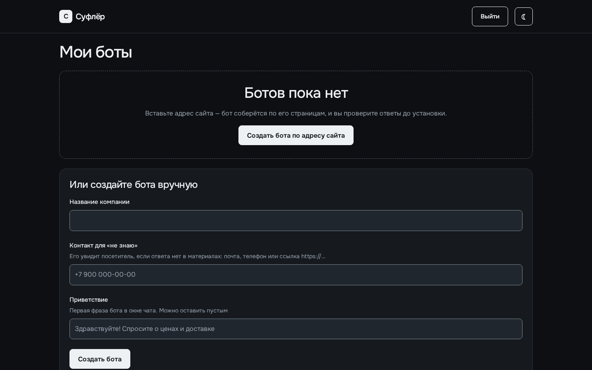</a></td><td><a href="assets/chatbase-doc-dashboard.png">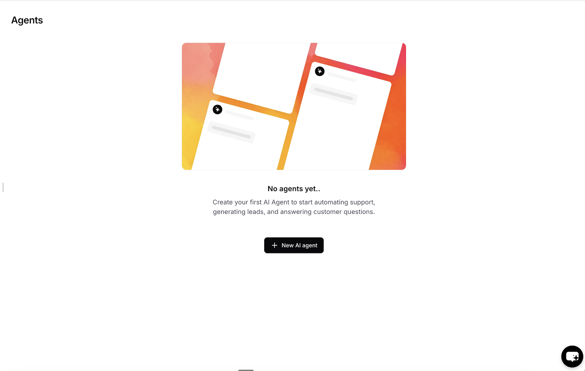</a></td><td><a href="assets/proposed-dashboard-dark-1440.png">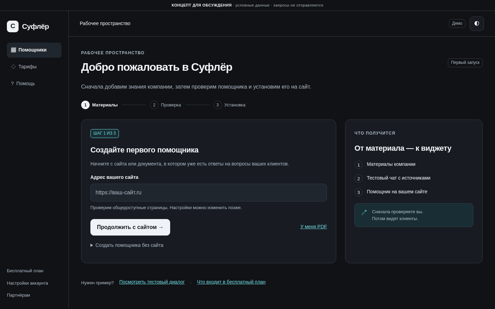</a></td></tr></table>

**Доказательства:** Живой кабинет предоставленного тестового аккаунта. Оригинал: Иллюстрация официальной документации Chatbase.

**Сейчас:** В пустом кабинете одновременно показаны путь через сайт и полная форма ручного создания. Пользователь выбирает способ и заполняет дополнительные сведения до знакомства с материалами.

**Предлагаем:** Один основной старт с источника и видимый путь «Материалы → Проверка → Установка». Ручной способ раскрывать по запросу.

**Критерий:** Владелец без подсказки называет текущий и следующий шаг. Для старта с сайтом на основном экране одно поле; альтернативный путь доступен явно.

**Объём:** UI + навигация. [Открыть HTML-концепт](prototype.html?screen=dashboard).

Источники: [Chatbase — первый помощник](https://www.chatbase.co/docs/user-guides/quick-start/your-first-agent), [USWDS — Step indicator](https://designsystem.digital.gov/components/step-indicator/), [NN/g — Progressive disclosure](https://www.nngroup.com/articles/progressive-disclosure/), [NN/g — Empty states](https://www.nngroup.com/articles/empty-state-interface-design/).

## U04 · Помочь вернуться в аккаунт

**P1 · Наблюдение + новая функция.**

<table><tr><th>Как сейчас</th><th>Как в Chatbase</th><th>Предлагаемый вариант</th></tr><tr><td><a href="assets/sufler-login-dark-1440.png">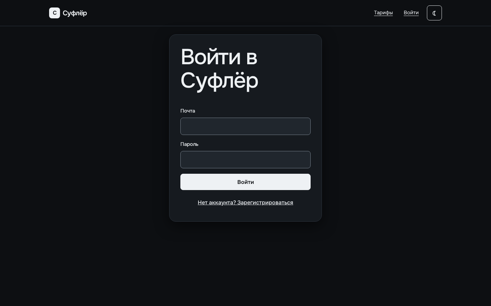</a></td><td><a href="assets/chatbase-login-1440.png">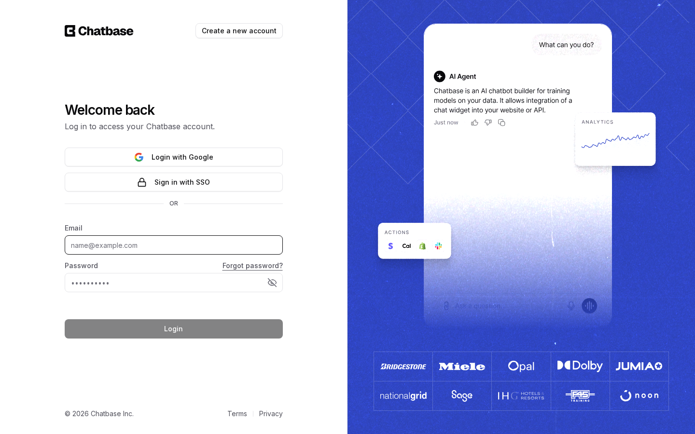</a></td><td><a href="assets/proposed-login-dark-1440.png">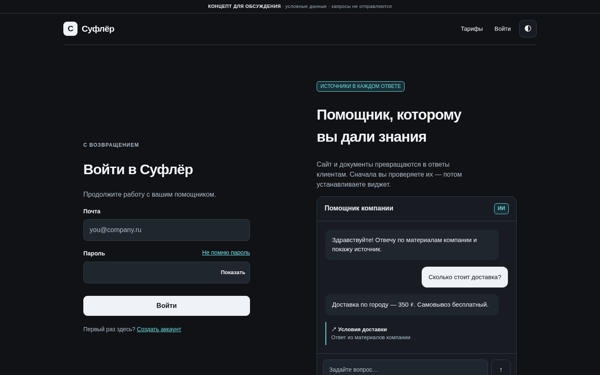</a></td></tr></table>

**Доказательства:** Живой публичный экран входа. Оригинал: Живой публичный экран Chatbase.

**Сейчас:** На форме нет видимого пути восстановления пароля и переключателя его видимости. Вход по действующему паролю проверен успешно.

**Предлагаем:** Добавить «Не помню пароль» и «Показать / Скрыть». Сохранить простой вход по почте; восстановление проектировать как полный серверный сценарий с письмом.

**Критерий:** Видимость управляется с клавиатуры и отражается в aria-pressed. Восстановление показывает отдельные успех и ошибку и не ограничивается декоративной ссылкой.

**Объём:** Переключатель — UI; восстановление — API + письмо. [Открыть HTML-концепт](prototype.html?screen=login).

Источники: [Chatbase — вход](https://www.chatbase.co/auth/signin), [GOV.UK — Text input](https://design-system.service.gov.uk/components/text-input/), [GOV.UK — Error summary](https://design-system.service.gov.uk/components/error-summary/), [W3C — Focus visible](https://www.w3.org/WAI/WCAG22/Understanding/focus-visible.html).

## U05 · Объяснить тариф через задачу бизнеса

**P2 · Гипотеза понятности.**

<table><tr><th>Как сейчас</th><th>Как в Chatbase</th><th>Предлагаемый вариант</th></tr><tr><td><a href="assets/sufler-pricing-dark-1440.png">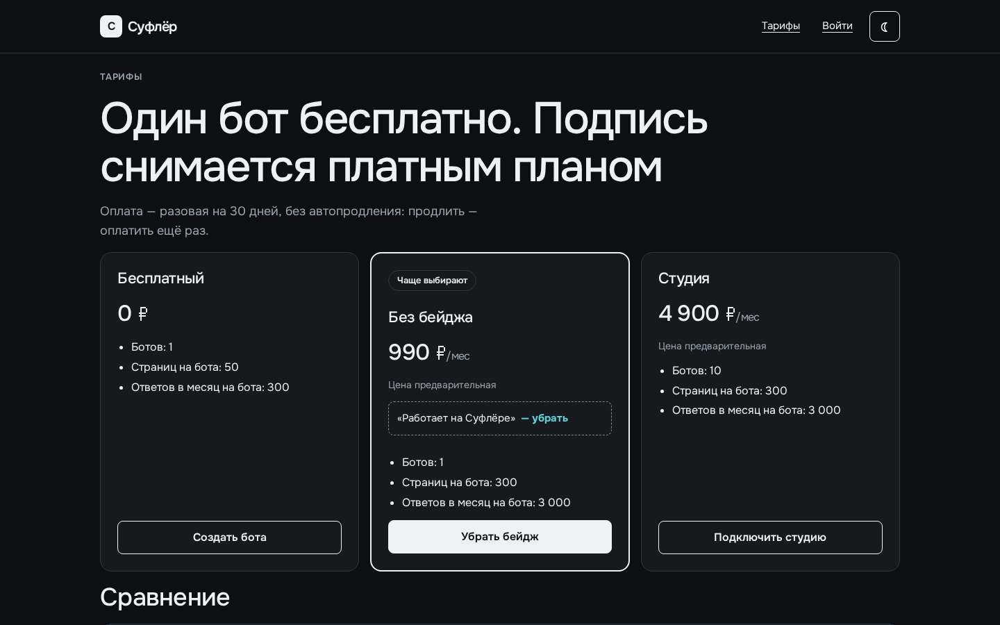</a></td><td><a href="assets/chatbase-pricing-1440.png">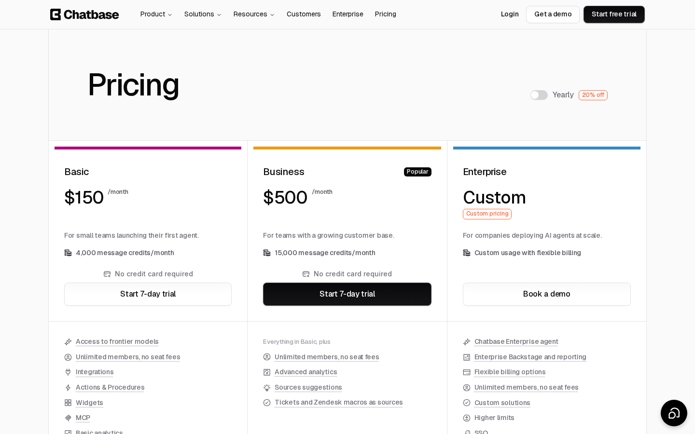</a></td><td><a href="assets/proposed-pricing-dark-1440.png">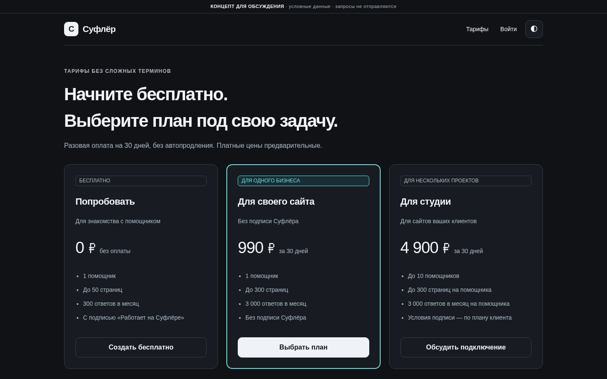</a></td></tr></table>

**Доказательства:** Живой публичный экран тарифов. Оригинал: Живой публичный экран Chatbase.

**Сейчас:** Названия «Без бейджа» и «Студия» требуют понимания терминов. Обоснование отметки «Чаще выбирают» этим аудитом не проверялось.

**Предлагаем:** Назвать задачи: «Попробовать», «Для своего сайта», «Для студии». Объяснить подпись простыми словами, сохранить реальные цены, лимиты, предварительность и оплату на 30 дней.

**Критерий:** В пяти пользовательских сессиях проверить понимание различий и условий; целевой результат определить до теста. Цены и возможности не меняются ради дизайна.

**Объём:** UI и тексты; продуктовая сверка условий. [Открыть HTML-концепт](prototype.html?screen=pricing).

Источники: [Chatbase — тарифы](https://www.chatbase.co/pricing), [NN/g — Progressive disclosure](https://www.nngroup.com/articles/progressive-disclosure/).

## U06 · Из ошибки вести к выполнимому действию

**P1 · UX-несогласованность в воспроизведённом состоянии.**

<table><tr><th>Как сейчас</th><th>Как в Chatbase</th><th>Предлагаемый вариант</th></tr><tr><td><a href="assets/sufler-preview-failed-1440.png">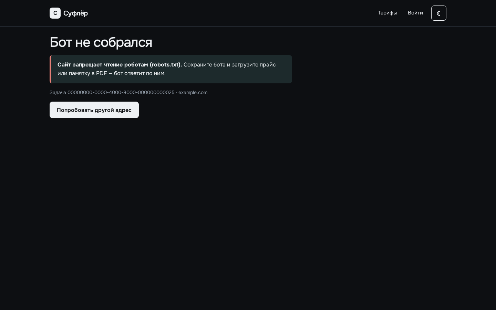</a></td><td><a href="assets/chatbase-doc-files.png">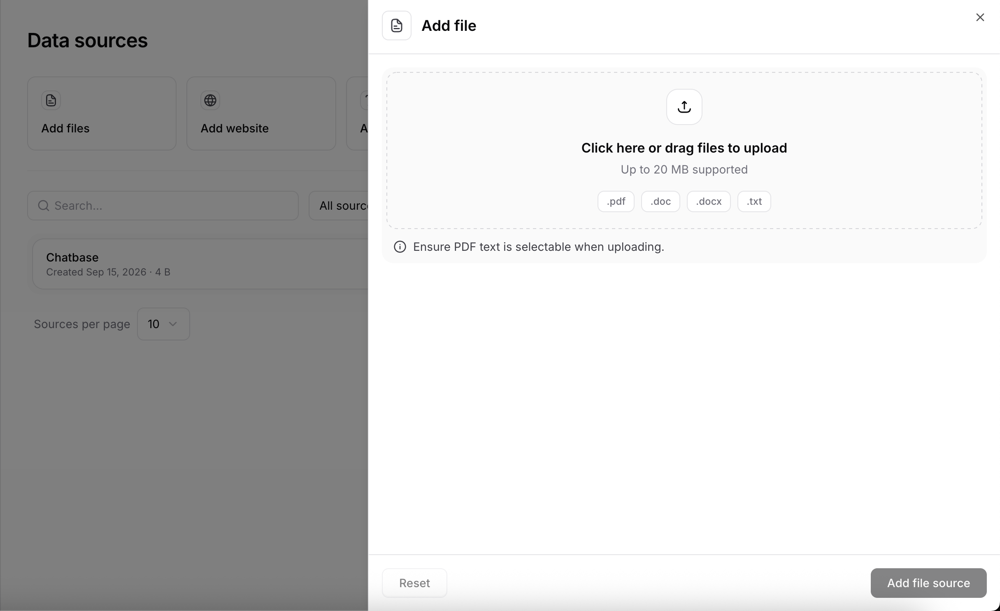</a></td><td><a href="assets/proposed-processing-dark-1440.png">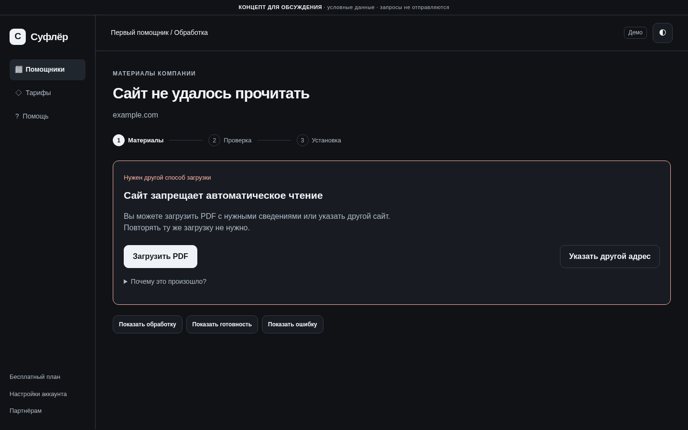</a></td></tr></table>

**Доказательства:** Настоящий frontend; состояние failed подменено в браузере. Оригинал: Иллюстрация официальной документации Chatbase.

**Сейчас:** При robots_disallowed текст предлагает сохранить бота и загрузить PDF, но единственная кнопка — «Попробовать другой адрес». Прямого перехода к предложенному PDF на экране нет.

**Предлагаем:** Дать два конкретных выхода: PDF и другой адрес. Объяснить необходимость входа для PDF, сохранить введённый адрес; технический ID убрать из основного сообщения.

**Критерий:** Из ошибочного состояния можно перейти к PDF по видимому действию. Проверить последовательность с входом и обратным переходом; не обещать сохранение несуществующего бота.

**Объём:** UI + маршрутизация; проверить условия сохранения. [Открыть HTML-концепт](prototype.html?screen=processing&state=error).

Источники: [Chatbase — источники](https://www.chatbase.co/docs/user-guides/chatbot/data-sources), [Google PAIR — Errors + graceful failure](https://pair.withgoogle.com/guidebook-v2/chapter/errors-failing/), [GOV.UK — Error summary](https://design-system.service.gov.uk/components/error-summary/), [GOV.UK — Validation](https://design-system.service.gov.uk/patterns/validation/), [W3C — Status messages](https://www.w3.org/WAI/WCAG22/Understanding/status-messages.html).

## U07 · Отделить проверку ответа от призыва к сохранению

**P1 · Гипотеза рабочего сценария.**

<table><tr><th>Как сейчас</th><th>Как в Chatbase</th><th>Предлагаемый вариант</th></tr><tr><td><a href="assets/sufler-preview-answer-1440.png">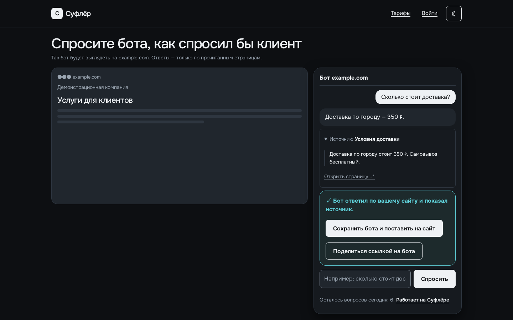</a></td><td><a href="assets/chatbase-doc-playground.png">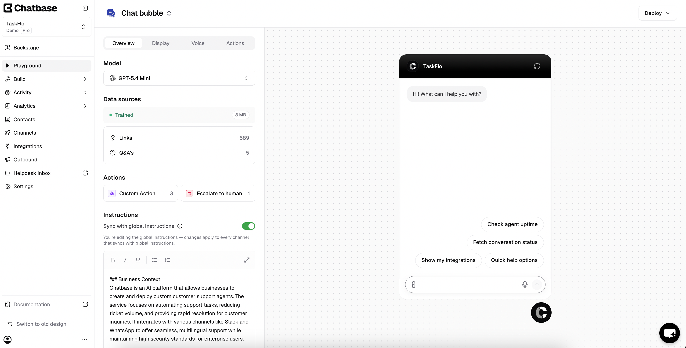</a></td><td><a href="assets/proposed-verify-dark-1440.png">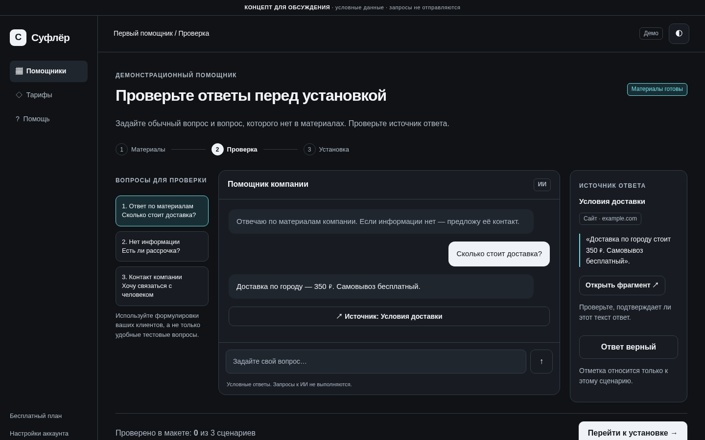</a></td></tr></table>

**Доказательства:** Настоящий frontend; ответ и источник подменены в браузере. Оригинал: Иллюстрация официальной документации Chatbase.

**Сейчас:** После первого ответа в ленте появляются сохранение и публикация ссылки. Источник уже виден — это сильная сторона, которую важно сохранить.

**Предлагаем:** Проверка по короткому списку: обычный вопрос, нехватка данных, контакт человека. Источник вынести в соседнюю панель; переход к установке — отдельно от сообщения.

**Критерий:** Можно проверить фрагмент и не потерять вопрос. Повторная отметка того же сценария не увеличивает счётчик. Чек-лист не означает гарантии качества всех ответов.

**Объём:** UI; сохранение списка проверок потребует отдельного решения. [Открыть HTML-концепт](prototype.html?screen=verify).

Источники: [Chatbase — Playground](https://www.chatbase.co/docs/user-guides/chatbot/playground), [Google PAIR — Explainability + Trust](https://pair.withgoogle.com/guidebook-v2/chapter/explainability-trust/), [Google PAIR — Errors + graceful failure](https://pair.withgoogle.com/guidebook-v2/chapter/errors-failing/), [Microsoft HAX — границы возможностей](https://www.microsoft.com/en-us/haxtoolkit/guideline/make-clear-what-the-system-can-do/).

## U08 · Уместить главное действие на коротком экране

**P2 · Измеренное наблюдение + макет.**

<table><tr><th>Как сейчас</th><th>Как в Chatbase</th><th>Предлагаемый вариант</th></tr><tr><td></td><td><a href="assets/chatbase-home-320x568.png">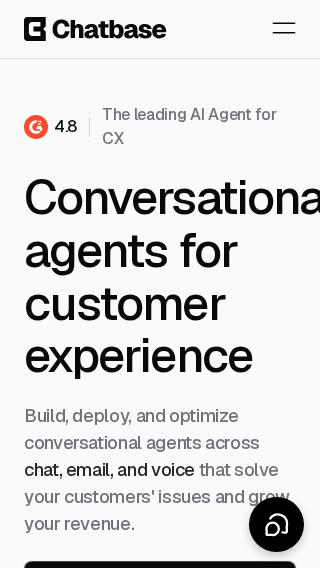</a></td><td><a href="assets/proposed-landing-dark-320x568.png">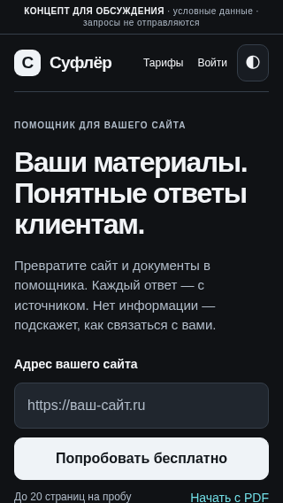</a></td></tr></table>

**Доказательства:** Живой мобильный viewport 320×568. Оригинал: Живой публичный Chatbase, тот же viewport 320×568.

**Сейчас:** На 320×568 кнопка создания находится на y=691…739, ниже первого экрана. На 375×667 и 390×844 основное действие уже помещается — общей поломки мобильной версии нет.

**Предлагаем:** Сократить первый экран, сохранить подпись поля и явную PDF-альтернативу. В макете на 320×568 кнопка расположена на y=494…542.

**Критерий:** Поле и основная кнопка полностью доступны в первом экране 320×568; нет горизонтальной прокрутки, поля не меньше 16 px, клавиатурный фокус видим.

**Объём:** UI и тексты. [Открыть HTML-концепт](prototype.html?screen=landing).

Источники: [W3C — Reflow](https://www.w3.org/WAI/WCAG22/Understanding/reflow), [GOV.UK — Text input](https://design-system.service.gov.uk/components/text-input/), [W3C — Target size minimum](https://www.w3.org/WAI/WCAG22/Understanding/target-size-minimum.html).

## U09 · Установка: скопировать → разместить → проверить

**P2 · Концепт для дополнительной проверки.**

<table><tr><th>Как сейчас</th><th>Как в Chatbase</th><th>Предлагаемый вариант</th></tr><tr><td></td><td><a href="assets/chatbase-doc-embed-code.png">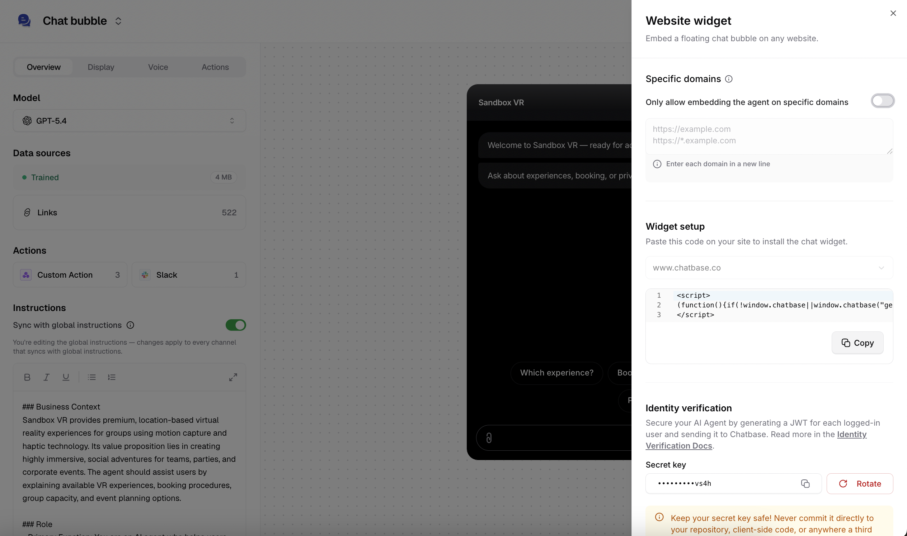</a></td><td><a href="assets/proposed-install-dark-1440.png">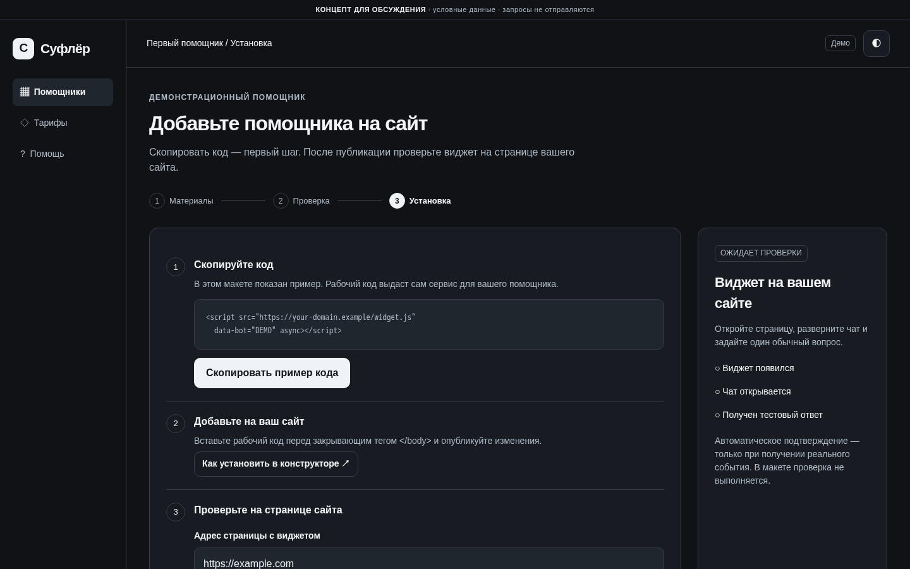</a></td></tr></table>

**Доказательства:** Последний проверенный переход; сам экран установки не исследован. Оригинал: Иллюстрация официальной документации Chatbase.

**Сейчас:** В предоставленном аккаунте нет ботов. Текущий заполненный кабинет и установка не проверены; отсутствие каких-либо функций не утверждается.

**Предлагаем:** Собрать установку в три шага и отделить «код скопирован» от «виджет работает». Это кандидат для сверки после появления тестового бота, не готовое требование переделки.

**Критерий:** Сперва проверить текущий экран с тестовым ботом. Подтверждать установку только реальным событием или явно обозначенной ручной проверкой.

**Объём:** Сначала дополнительный аудит; затем оценка. [Открыть HTML-концепт](prototype.html?screen=install).

Источники: [Chatbase — установка](https://www.chatbase.co/docs/user-guides/chatbot/channels), [USWDS — Process list](https://designsystem.digital.gov/components/process-list/), [W3C — Status messages](https://www.w3.org/WAI/WCAG22/Understanding/status-messages.html).

## Ограничения

- Только Chromium 156 / Playwright 1.64.1 в выделенном контейнере; Safari/WebKit и реальные телефоны не проверялись.
- Заполненный кабинет бота и действующий экран установки не исследованы: предоставленный аккаунт пустой. Новые боты не создавались.
- Скриншоты ошибок и ответов — управляемые UI-состояния с подменой данных в браузере, а не реальные результаты индексации или работы ИИ.
- Изображения закрытых экранов Chatbase взяты из официальной документации; дата исходной съёмки издателем не указана. Это не снимки нашего авторизованного кабинета и не доказательство исторической версии, по которой первоначально делалась копия.
- Критерии в карточках — цели будущей приёмки. Интервью и usability-тестов с владельцами бизнеса ещё не проводили.
- Восстановление пароля и новые сохранённые состояния потребуют реализации за пределами вёрстки; соответствующие зависимости указаны в карточках.

## Как воспроизвести

Контейнер и сценарии: [tools/ui-ux-audit](../../../tools/ui-ux-audit/README.md). Артефакты исходного запуска находятся на VPS в `/home/research/sufler-ui-ux/artifacts/`. Авторизация и сырые приватные данные не коммитятся. Публичные изображения и их SHA-256 — [assets-manifest.json](assets-manifest.json); происхождение оригиналов — [reference-provenance.json](reference-provenance.json).
