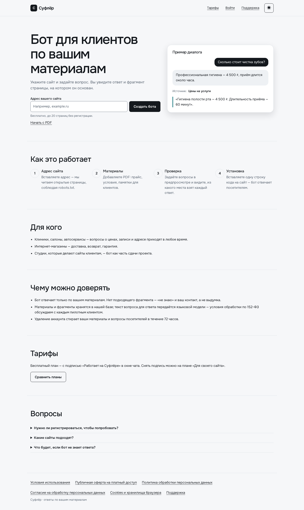
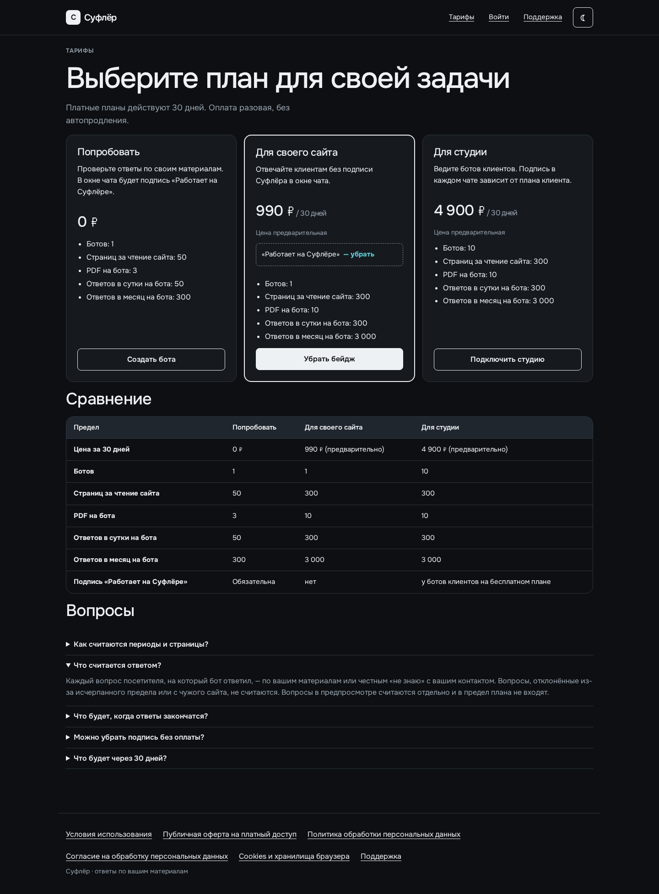
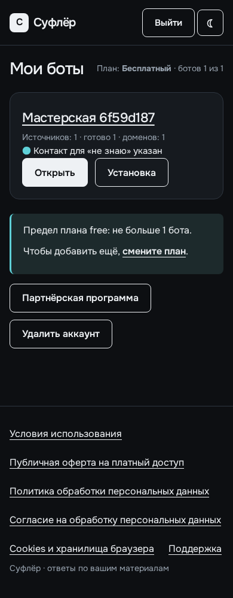
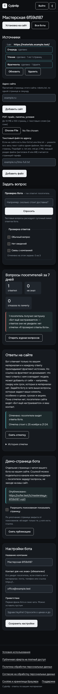
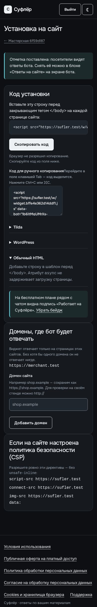
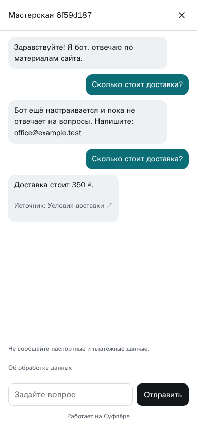

# Проверка обновлённого интерфейса Суфлёра

[Открыть учебный кабинет](https://sufler-preview.78.17.53.233.sslip.io/__preview). Это отдельная демоверсия с синтетическими данными. Основной `sufler.site` пока не переключён. Настоящие почта, поддержка и платежи отключены.

Снимки ниже сделаны в Chromium 156.0.8078.4 на реальном локальном Next-приложении, а не в статическом макете. Сборка `R8u2VkzHPZwAUwGc2g6Yn`; исходники 299 файлов совпали с собранным образом. Его идентификатор и хэш исходного снимка записаны в `visual-observations.json`. [Контрольные суммы файлов](artifact-hashes.json).

| Экран | Светлая тема | Тёмная тема |
|---|---|---|
| Главная | [Открыть](landing-light.png) | [Открыть](landing-dark.png) |
| Тарифы | [Открыть](pricing-light.png) | [Открыть](pricing-dark.png) |
| Старт с PDF | [Открыть](preview-light.png) | [Открыть](preview-dark.png) |
| Вход | [Открыть](login-light.png) | [Открыть](login-dark.png) |
| Поддержка | [Открыть](support-light.png) | [Открыть](support-dark.png) |

## Главная

## Тарифы

Цены и квоты сохранены. Проверены реальные четыре публичных значения окружения: 50/300 ответов в сутки и 300/3000 в месяц. Карточки и таблица совпадают с ними. Подпись страниц уточнена: предел действует за одно чтение сайта; календарные периоды ответов отличаются от оплаченных 30 дней. Исследование понимания тарифов с пятью участниками пока не проводилось и запланировано отдельно.

## Заполненный кабинет и бот

Эти экраны сняты на настоящих маршрутах той же сборки в 390×844, тёмная тема. Владелец, материалы и ответ созданы тестовым сценарием; настоящих клиентских данных здесь нет.

## Установка и внешний сайт

[Квитанция U09](observation.json) фиксирует отдельный origin, скопированный серверный тег, CORS, CSP и события первого config/answer. Проверены настоящий отказ разрешения буфера обмена до и после успешного копирования, понятный статус и точное выделение кода клавишей Tab. Исходный сценарий установки сохранён; добавлен доступный способ ручного копирования. Источник и ответ синтетические: эта проверка не оценивает качество DeepSeek или Cloud.ru.

## Что проверено

- Полный Docker-набор: 1260 тестов, 75 файлов, без пропусков; настоящие PostgreSQL и Redis в отдельной внутренней сети.
- 321 проверка прежних компонентных браузерных наборов в Chromium. Они включают SSR, гидрацию и подменные API; это не 321 полный путь через Next.
- 30 проверок настоящих Next-маршрутов в пяти изолированных файлах. Неверное ожидание включённой почты в новом клавиатурном тесте исправлено на фактический `disabled`; исходный журнал сохранён. Отдельные файлы не делят эфемерные счётчики rate limit, внутри сценариев ограничения сохранены.
- 10 сочетаний страницы и темы при 1440×1000: axe не обнаружил нарушений по тегам WCAG A/AA и 2.1 AA. Это автоматизированная проверка, не полный аудит доступности. В основных сценариях отдельно проверены ввод, фокус, Enter, Space, Tab и обратный Tab; это не исследование с людьми или экранным диктором.
- Полный парный нагрузочный прогон ещё идёт. Финальные QE-условия и выпуск не объявлены завершёнными.

WebKit не устанавливался и не проверялся. Браузер работал только в выделенном контейнере на VPS. Итоговая приёмка и ограничения будут записаны в Step 8/9 обеих фич.
